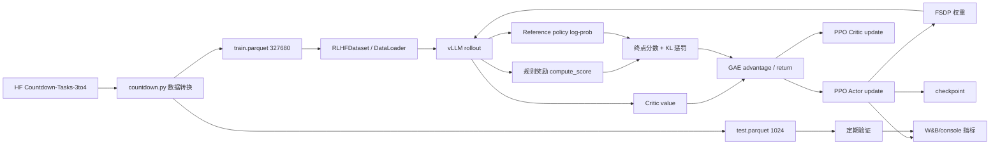

# TinyZero 项目总览与证据索引

> 复盘日期：2026-11-12（Asia/Shanghai）  
> 仓库：`TinyZero`，当前提交 `95df88f`（`main`，与 `origin/main` 一致）  
> 本文只引用当前工作区代码、配置、Git 历史及本次会话中曾核验的实验记录；不把 README 宣传值当作本地实验结果。

## 1. 审计范围、方法与证据等级

本工作区识别出 **1 个主要项目 TinyZero**。它不是从零实现的独立训练框架，而是在 veRL/HybridFlow 基础上增加 Countdown、Multiply 等可验证推理任务的数据构建、规则奖励和训练入口，用小规模基础语言模型复现“无需 SFT、仅靠强化学习出现搜索和自校验行为”的 R1-Zero 风格实验。

证据分级如下：

| 等级 | 含义 | 本报告中的使用方式 |
|---|---|---|
| A：当前可验证 | 当前仓库中的代码、配置、Git 对象，可定位到路径和行号 | 可作为实现事实与默认参数依据 |
| B：历史实验记录 | 此前会话中已从服务器日志、checkpoint 或严格评测输出核验，但当前审计时服务器连接超时 | 可报告数值，但明确记录远端证据路径和本次不可复查状态 |
| C：文档报告 | README、注释或上游文档中的陈述 | 只能表述为“项目文档称”，不能冒充本次实验结果 |
| D：代码存在未验证 | 有实现或命令，但没有运行日志/产物 | 表述为“支持/已实现”，不表述为“已完成验证” |
| E：缺失/待确认 | 没有足够证据 | 不下结论，列入交接清单 |

本次未运行训练、未安装依赖、未下载模型或数据、未调用外部服务。尝试以只读 SSH 连接历史实验服务器时在 banner exchange 阶段超时，因此远端日志没有复制到本地。公开版本不记录内部服务器地址。

## 2. 项目最初要解决的问题

DeepSeek-R1-Zero 展示了基础模型可通过大规模强化学习形成推理行为，但完整方案训练成本高、基础设施复杂且难以复现。TinyZero 将问题缩小为可程序验证的数字运算任务：给定一组数字和目标值，模型必须使用每个数字恰好一次，并通过 `+ - * /` 构造等于目标值的表达式。

核心目标可拆为四点：

1. 使用 Qwen2.5 系列基础模型，而不是依赖人工思维链 SFT 数据，验证纯 RL 是否能提升可验证推理能力。
2. 用确定性规则奖励替代昂贵且存在偏差的神经奖励模型。
3. 利用 veRL 的 Ray、FSDP 与 vLLM 混合引擎，在有限 GPU 上完成 rollout、价值估计和 PPO 更新。
4. 通过验证集奖励和严格表达式正确率判断改进，而非只观察训练 loss。

README 声称 3B base LM 能发展出自校验和搜索能力，并提示 0.5B base 在该任务上无法学会推理。这属于 C 级项目陈述；当前本地仓库没有与该宣传结论配套的原始曲线文件。

## 3. 总体技术架构



实际默认训练入口是 `scripts/train_tiny_zero.sh`，调用 `python3 -m verl.trainer.main_ppo`。Hydra 合并 `verl/trainer/config/ppo_trainer.yaml` 与命令行覆盖项；`main_ppo.py` 创建 Ray worker、tokenizer、规则奖励管理器和 `RayPPOTrainer`；训练循环调用 vLLM 采样、参考策略、critic、reward、GAE、PPO actor/critic 更新，并按频率验证和保存。

## 4. 项目结构与功能映射

| 子系统 | 核心路径 | 作用 | 完成状态 | 证据 |
|---|---|---|---|---|
| 项目入口与说明 | `README.md`, `OLD_README.md` | TinyZero 使用说明、veRL 上游说明 | 已完成；仓库已声明停止维护 | A/C |
| Countdown 数据 | `examples/data_preprocess/countdown.py` | 从 HF 数据集选择连续区间，生成 prompt、规则真值、元数据并写 Parquet | 已实现；历史实验中实际使用 | A/B |
| Multiply/其他数据 | `examples/data_preprocess/multiply.py`, `arth.py`, `gsm8k.py` | 其他任务转换 | 代码存在，本轮项目实验未核验 | D |
| 数据读取 | `verl/utils/dataset/rl_dataset.py` | 读 Parquet、抽取 prompt、tokenize、左填充、生成 position id | 已实现并被主训练器调用 | A |
| Countdown 奖励 | `verl/utils/reward_score/countdown.py` | 提取 `<answer>`，校验数字集合，安全受限求值，给 0/0.1/1 分 | 已实现并实际使用 | A/B |
| PPO 编排 | `verl/trainer/main_ppo.py`, `verl/trainer/ppo/ray_trainer.py` | Ray 资源池、rollout、reward、advantage、更新、验证、保存 | 已实现并实际运行 | A/B |
| 核心算法 | `verl/trainer/ppo/core_algos.py` | GAE、GRPO advantage、KL、PPO clipped loss、value loss | PPO 路径已运行；GRPO 路径未在当前实验中运行 | A/B/D |
| Actor/Critic | `verl/workers/actor/dp_actor.py`, `verl/workers/critic/dp_critic.py` | 前向、loss、梯度累积、裁剪、优化 | 已实现并实际运行 | A/B |
| 分布式执行 | `verl/workers/fsdp_workers.py`, `verl/single_controller/ray/*` | FSDP 模型、Ray RPC、worker group、资源复用 | 已实现并实际运行 | A/B |
| Rollout | `verl/workers/rollout/vllm_rollout/*` | vLLM 批量生成 | 已实现并实际运行 | A/B |
| 日志 | `verl/utils/tracking.py` | console/W&B/MLflow 聚合 | W&B 实际使用；SwanLab 非仓库原生后端 | A/B |
| 生成与离线评测 | `verl/trainer/main_generation.py`, `main_eval.py` | 生成和分数计算 | 框架代码存在；严格评测脚本未进入当前 Git 工作树 | D/B |
| 测试 | `tests/` | 单元、Ray、rollout、e2e 测试 | 大量测试存在；本次未执行，不能声明通过 | D |

## 5. 数据流与核心数据格式

`countdown.py` 输出的每行 Parquet 逻辑结构为：

```json
{
  "data_source": "countdown",
  "prompt": [{"role": "user", "content": "...<think>"}],
  "ability": "math",
  "reward_model": {
    "style": "rule",
    "ground_truth": {"target": 24, "numbers": [3, 4, 6, 8]}
  },
  "extra_info": {"split": "train", "index": 0}
}
```

默认划分直接按源数据顺序切片：前 327,680 条训练，随后 1,024 条测试。代码没有 shuffle、基于规范化题目的去重，也没有单独 validation/test 双集合；训练脚本把 `test.parquet` 配置成 `data.val_files`，所以它在训练过程中反复用于选 checkpoint，严格意义上应称为验证集而非最终盲测集。

## 6. 依赖关系与技术选型

- PyTorch：模型训练与张量计算。
- Transformers `<4.48`：Qwen 等 Hugging Face 模型与 tokenizer。
- Ray：控制器和远程 worker 编排。
- FSDP：actor、critic、reference 的参数分片和分布式训练。
- vLLM `<=0.6.3`：高吞吐 rollout。
- Hydra/OmegaConf：配置覆盖。
- pandas/pyarrow/datasets：Parquet 与 Hugging Face 数据处理。
- W&B：实验指标可视化。

选 PPO 而非当前更常见的 GRPO，主要是 TinyZero 当时的默认训练链路已经具备完整 actor-critic、GAE 和稳定的 clip/KL 控制；GRPO 虽已在代码中支持，但需要 `rollout.n > 1`、分组归一化并取消 critic。当前实验沿用官方脚本，所以实际技术债是多维护一份 critic，显存和计算成本更高。

## 7. 完成情况

### 已确认完成

- Countdown 数据转换、规则奖励、PPO 训练链路可运行。
- Qwen 基础模型 checkpoint、数据与环境曾部署到训练服务器。
- 初始 PPO 训练完成并保存 checkpoint。
- 从 step 300 checkpoint 进行低学习率、增强 KL/entropy 的 200-step 续训。
- 续训中每 50 step 验证/保存；最优验证点为续训 step 150。
- 对原始 step 300 和续训 step 150 做过同口径严格评测。
- W&B 记录训练曲线；单次 actor gradient norm 尖峰经代码和相邻指标核查未形成发散。

### 部分完成

- 有规则验证，但没有独立、从未用于调参的 held-out test；现有 `test.parquet` 实际充当 validation。
- 有严格评测结果，但严格评测脚本和输出当前不在本地 Git 工作树中。
- 讨论过用最优模型生成 400 条正确推理样本进行冷启动 SFT，但没有产物证明已执行。

### 尚未完成或缺证据

- 独立盲测集与统计显著性/多随机种子评测。
- 400 条合成 SFT 数据、质量审计和冷启动模型。
- PPO 与 GRPO 同预算对照、关键超参数消融。
- 推理服务或生产部署。
- GPU 成本、吞吐、端到端延迟的系统记录。

## 8. 开发时间线

| 时间 | 事件 | 证据 |
|---|---|---|
| 2024-10 至 2025-01 | veRL 基础框架、vLLM 0.6.3、Ray/FSDP、GRPO 等能力逐步进入仓库 | Git 历史，A |
| 2025-01-21 至 01-24 | 增加 TinyZero README、Countdown 数据/奖励；修复 answer 提取和 Qwen-Instruct 模板 | commits `5c10cc8`, `3628840`, `c97c891`, `4d92412`，A |
| 2025-03-10 | 开启 remove padding/dynamic batch，并把 PPO mini-batch 128 降到 64，解决 Ray OOM | commit `96b4d57`，A |
| 2026-02-26/27 | 仓库增加停止维护提示并更新文档 | `2480532`, `95df88f`，A |
| 2026-09（历史会话） | 本地上传模型/数据、配置环境、初始训练、续训、W&B、严格评测 | B；服务器日志路径见实验文档 |
| 2026-11-12 | 离职前审计；本地工作树干净；远端只读连接超时 | 本报告，A |

## 9. 关键风险

1. **测试集复用风险**：训练时每 50/100 step 查看同一 `test.parquet`，已使它成为验证集。
2. **奖励与准确率混淆**：错误但格式/数字合法可得 0.1 分，因此 `val/test_score/countdown` 不是 exact accuracy。
3. **浮点与表达式解析**：规则允许小数点字符，但数字使用校验会把小数字面量拆为多个整数；`eval` 虽有限制字符和 builtins，仍宜改用 AST 白名单解释器。
4. **源码与实验产物分离**：日志、checkpoint、严格评测脚本未纳入当前工作区，复现证据不闭环。
5. **个人归属不足**：Git 作者列表无 `zihao.hu4`，不能从仓库历史证明个人代码提交。

## 10. 本报告建议的项目定义

在简历、面试或交接中，准确表述应是：

> 基于开源 TinyZero/veRL 完成 Countdown 可验证推理任务的环境部署、PPO 训练、稳定性调参与严格评测；通过降低 actor 学习率、提高 KL 约束和加入 entropy bonus 完成 200-step 续训，在同一 1,024 条评测集上将严格正确率从 51.27% 提升到 52.246%（+0.976 个百分点），但该集合参与 checkpoint 选择，尚需独立 held-out test 验证泛化。

这一区分了上游框架作者的贡献与本次实习阶段可核验的实验工程贡献。
