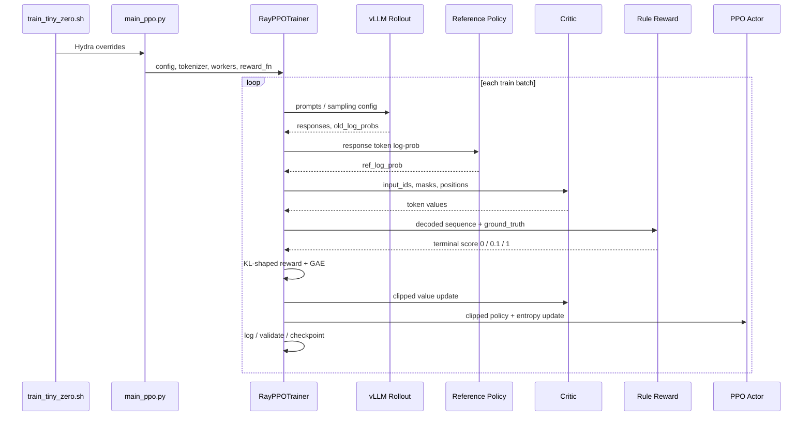

# TinyZero 技术方案与核心实现

## 1. 设计目标与约束

TinyZero 把开放式语言推理转化为一个可验证的序列决策问题。输入是目标值和 3–4 个数字，输出同时包含自由文本推理和最终表达式。最终表达式可以被程序精确验证，从而不需要训练神经奖励模型，也不需要人工逐条标注偏好。

工程约束包括：长响应（脚本上限 1,024 token）、模型训练与推理共享 GPU、rollout 计算量远大于普通监督学习、actor/reference/critic 多份模型造成显存压力，以及稀疏终点奖励带来的高方差。项目选择 veRL 的混合引擎，用 vLLM 做采样、FSDP 做参数分片、Ray 做 worker 编排，并采用 PPO+GAE 稳定更新。

## 2. 端到端调用链



## 3. 数据构建

### 3.1 数据源与切分

`examples/data_preprocess/countdown.py:88` 调用：

```python
load_dataset('Jiayi-Pan/Countdown-Tasks-3to4', split='train')
```

随后用连续位置切片构建默认 327,680 条 train 和 1,024 条 test（第 91–92 行）。`--num_samples`、`--num_operands`、`--max_target` 等参数及 `gen_dataset()` 保留在代码中，但主路径没有调用该生成函数；因此不能把这些参数当作真实数据构建配置。真实路径依赖现有 HF 数据集字段 `target` 和 `nums`。

### 3.2 Prompt 模板

`make_prefix()` 支持 `base` 和 `qwen-instruct` 两种模板。base 模板显式要求：

- 使用给定的每个数字，且只使用一次；
- 允许 `+ - * /`；
- 推理写入 `<think>...</think>`；
- 最终表达式写入 `<answer>...</answer>`。

模板末尾已经包含 `Assistant: ... <think>`，使基础模型从推理区开始续写。Qwen-Instruct 版本使用 `<|im_start|>` / `<|im_end|>`。Git commit `4d92412` 同步修改 reward extractor，使其识别 instruct assistant 标记。这说明模板和奖励解析必须配套，否则模型即使输出正确表达式也可能被打 0 分。

### 3.3 数据结构

每条数据保留 prompt、规则真值和索引。`RLHFDataset.__getitem__()`（`verl/utils/dataset/rl_dataset.py:120`）取 `chat[0]['content']`，调用 `tokenize_and_postprocess_data` 做左填充/截断，并生成 `input_ids`、`attention_mask`、`position_ids`。`extra_info.index` 被提升为顶层 `index`，供 GRPO 分组使用；PPO/GAE 路径不依赖它。

### 3.4 数据风险

- 代码按顺序切分，没有随机化、题目规范化去重或分层抽样。
- 没有独立 validation 和 test；`test.parquet` 被训练脚本当 validation。
- 对 Countdown，建议按 `(tuple(sorted(nums)), target)` 去重和分组切分，避免数字顺序变化造成近重复泄漏。
- 源数据如何生成、是否保证有解、3 数/4 数比例，当前仓库没有构建说明，需读取数据卡或保存本地统计后确认。

## 4. 规则奖励

### 4.1 提取流程

`verl/utils/reward_score/countdown.py` 的处理顺序是：

1. 找到 `Assistant:` 或 `<|im_start|>assistant`；
2. 只保留整段输出的最后一行；
3. 从最后一行找全部 `<answer>...</answer>`，取最后一个；
4. 正则提取表达式中的整数，与可用数字排序后完全比较；
5. 只允许数字、四则运算、括号、小数点和空白；
6. 在禁用 builtins 的环境中 `eval`；
7. 与目标误差小于 `1e-5` 得 1 分；格式/数字合法但数值错误得 0.1；无法提取得 0。

奖励函数可写为：

\[
r(y;x)=
\begin{cases}
1, & \text{format valid, multiset(numbers) exact, } |f(e)-t|<10^{-5}\\
0.1, & \text{answer extracted and number usage valid, but result wrong/invalid}\\
0, & \text{answer cannot be extracted}
\end{cases}
\]

`RewardManager.__call__()` 在 `verl/trainer/main_ppo.py` 中解码 prompt+response，按 `data_source` 选择 scorer，并只把标量奖励写到最后一个有效响应 token。这是典型 outcome reward，而非过程奖励。

### 4.2 为什么采用规则奖励

- 精确、便宜、无需偏好标注和奖励模型训练；
- 不存在 reward model 自身泛化误差；
- 适用于大量 rollout 的在线打分；
- 对最终数学正确性有可解释约束。

代价是中间推理不被验证。模型可能在 `<think>` 中写错误过程，但最终碰巧给出正确表达式；也可能利用解析器边界。因此“出现推理文本”不能直接等价为“学会忠实推理”。

### 4.3 实现缺陷

- `solution_str.split('\n')[-1]` 要求 `<answer>` 在最后一行；尾部多一个换行或说明可能导致误判。
- 数字检查使用 `\d+`，无法正确支持负数字面量或小数；虽然题目数字为正整数，但表达式中的中间负数不应写成新字面量。
- `method` 参数没有被使用。
- `ast`、`operator` import 未使用，说明原本可能计划 AST 解析但最终仍用 `eval`。
- “格式正确但答案错误”固定奖励 0.1 会提高 reward mean，却不会提高 exact accuracy。

建议将评分拆成 `format_ok`、`number_multiset_ok`、`value_ok` 三个布尔指标，并用 AST 白名单解释器替代 `eval`。

## 5. PPO 数学与代码映射

### 5.1 KL 约束奖励

默认 `use_kl_loss=False`，所以训练器在 reward 层应用 KL 惩罚。`apply_kl_penalty()` 计算 token-level：

\[
r_t = s_t - \beta\,k_t,
\quad k_t=\log \pi_{old}(a_t|s_t)-\log \pi_{ref}(a_t|s_t)
\]

其中只有最后有效 token 的 `s_t` 非零。默认固定 `β=0.001`；续训实验改为 `0.005`，用更强约束限制策略偏离 reference。

### 5.2 GAE

`compute_gae_advantage_return()`（`core_algos.py:70`）反向遍历 token：

\[
\delta_t=r_t+\gamma V(s_{t+1})-V(s_t)
\]

\[
A_t=\delta_t+\gamma\lambda A_{t+1},\qquad R_t=A_t+V(s_t)
\]

默认 `gamma=1.0`、`lam=1.0`，然后仅在有效响应 mask 上 whiten advantage。由于奖励在序列末端且无折扣，价值网络负责把终点信号传播到前面的生成 token。

### 5.3 PPO clipped policy loss

令重要性比率：

\[
\rho_t(\theta)=\exp(\log\pi_\theta(a_t|s_t)-\log\pi_{old}(a_t|s_t))
\]

策略损失采用：

\[
L_{PG}=-\mathbb{E}_t\left[\min(\rho_t A_t,
\operatorname{clip}(\rho_t,1-\epsilon,1+\epsilon)A_t)\right]
\]

默认 `clip_ratio=0.2`。`DataParallelPPOActor.update_policy()` 在每个 micro-batch 计算 entropy、log_prob、policy loss，然后：

\[
L_{actor}=L_{PG}-c_H\mathbb{E}[H(\pi_\theta)]
\]

代码配置键是 `entropy_coeff`，历史续训命令中俗称 `entropy_coef=0.001`。需要注意拼写必须匹配当前代码，否则 Hydra 可能拒绝或生成未使用字段。

### 5.4 Critic loss

`compute_value_loss()` 使用对旧 value 的 clipped regression，降低价值函数单步变化：

\[
V^{clip}=\operatorname{clip}(V_\theta,V_{old}-\epsilon_v,V_{old}+\epsilon_v)
\]

\[
L_V=\frac{1}{2}\mathbb{E}[\max((V_\theta-R)^2,(V^{clip}-R)^2)]
\]

默认 `cliprange_value=0.5`，critic 学习率为 `1e-5`。

### 5.5 梯度裁剪与尖峰解释

`dp_actor.py:143-151` 调用 FSDP 或 PyTorch `clip_grad_norm_(max_norm=grad_clip)`，返回值是裁剪前总梯度范数，然后执行 optimizer step。默认 `grad_clip=1.0`。因此 W&B 中 step 160 的 `actor/grad_norm=8.693` 表示裁剪前尖峰，实际更新已受 1.0 上限约束；相邻 step 回到约 0.5–0.9，且验证指标没有同步崩溃，不能据此判断训练发散。

## 6. PPO 与 GRPO 的实现差异

当前代码同时支持：

- `adv_estimator=gae`：启用 critic，`rollout.n=1` 即可；
- `adv_estimator=grpo`：禁用 critic，要求同一 prompt 多次采样，通过 `index` 分组标准化 outcome reward。

GRPO advantage 在 `compute_grpo_outcome_advantage()` 中为：

\[
A_i=\frac{R_i-\mu_{g(i)}}{\sigma_{g(i)}+\epsilon}
\]

并把同一 response 的标量 advantage 广播到所有有效 token。其优点是去掉 critic，减少显存和价值估计偏差；缺点是每题需多个 rollout，生成成本增加，组内奖励全相同时学习信号可能退化。

本项目实际实验沿用 PPO，原因是官方脚本和 checkpoint 链路已经基于 actor-critic/GAE，且历史实验没有留下 GRPO 同预算对照。因此不能声称 PPO 优于 GRPO，只能说它是已验证可运行的路径。

## 7. 训练编排与资源管理

`main_ppo.py` 根据 `actor_rollout_ref.actor.strategy` 选择 FSDP 或 Megatron worker；本项目脚本使用默认 FSDP。ActorRollout、Critic 和 RefPolicy 映射到同一 global resource pool。`ActorRolloutRefWorker` 在训练和 vLLM rollout 间切换权重/显存状态，实现 hybrid engine。

`RayPPOTrainer.fit()` 的关键顺序：

```text
for epoch:
  for prompt_batch:
    rollout.generate_sequences()
    actor.compute_old_log_prob()
    ref.compute_ref_log_prob()
    critic.compute_values()
    reward_fn()
    apply_kl_penalty()
    compute_gae_advantage_return()
    critic.update()
    actor.update()
    validate if step % test_freq == 0
    save if step % save_freq == 0
    logger.log()
```

训练器在达到 `total_training_steps` 后还会执行 final validation。日志里出现比预期多 1 个终点值时，应检查 `global_steps` 初值、递增位置和恢复训练时步数定义，避免把“201 个日志点”误写为“201 次新增更新”。

## 8. 默认与实际参数

官方 `scripts/train_tiny_zero.sh` 覆盖：

| 参数 | 默认脚本值 |
|---|---:|
| train batch | 256 |
| val batch | 1312 |
| max prompt / response | 256 / 1024 |
| actor lr | 1e-6 |
| critic lr | 1e-5 |
| PPO mini/micro batch | 64 / 8 |
| KL coefficient | 0.001 |
| rollout GPU memory utilization | 0.4 |
| save/test frequency | 100 / 100 |
| epochs | 15 |
| dynamic batch/remove padding | true / true |

续训实验的关键覆盖为 actor lr `2e-7`、KL coefficient `0.005`、entropy coefficient `0.001`、新增约 200 updates、test/save frequency 50。其余参数必须从保存的 resolved Hydra config 或完整启动日志复核，不能假设全部继承无误。

## 9. 关键工程修复

### 9.1 Ray OOM

Git commit `96b4d57` 的说明明确指出 OOM 出现在 `ref_compute_ref_log_prob`。修复包含三项：开启 `use_remove_padding`，开启 `use_dynamic_bsz`，把 PPO mini-batch 从 128 降为 64。动态 batch 按 token 数而非样本数拆 micro-batch，减少长序列造成的峰值显存；remove padding 避免在 padding token 上浪费计算。

### 9.2 Qwen-Instruct 解析失败

commit `c97c891` 增加 instruct prompt，`4d92412` 又为 reward extractor 增加 `<|im_start|>assistant` 分支。问题根因是数据模板改变但 scorer 仍只识别 `Assistant:`；解决方式是同步支持两种 assistant marker。

### 9.3 训练稳定性

初始训练后为控制策略漂移和潜在 entropy/KL 风险，续训将 actor lr 降至原来的 20%，KL coefficient 提高 5 倍，并保留/明确 entropy bonus 0.001；同时把验证/保存间隔缩短到 50 step，以更细粒度观察是否继续提升。结果在 step 150 达到局部最佳，step 200/201 轻微回落，支持早停而不是无限续训。

## 10. 实现状态结论

项目具备完整、可运行的 Countdown PPO 训练闭环；算法和工程模块衔接清晰。主要不足不在“能否跑通”，而在评测协议和实验资产管理：没有真正 held-out test、没有多 seed、严格评测脚本/结果未进入工作区、resolved config 未归档。后续优先级应是补齐证据闭环，而不是继续盲目增加训练步数。
