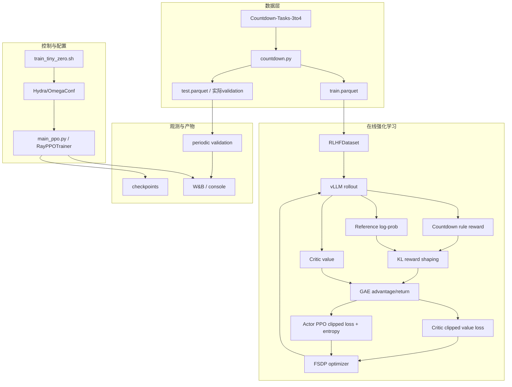

# TinyZero 完整项目技术复盘报告

> 文档性质：离职前内部技术复盘与交接材料  
> 审计日期：2026-11-12  
> 审计对象：当前 Codex Workspace 中的 TinyZero 仓库  
> 当前版本：`main@95df88f`  
> 保密要求：仅在授权工作空间内使用，不包含密钥，不擅自导出模型、内部日志或数据

## 摘要

TinyZero 是一个基于 veRL 的小规模可验证推理强化学习项目，目标是在 Countdown 和乘法等任务上复现 DeepSeek-R1-Zero 风格的“基础模型不经思维链监督微调，仅通过强化学习形成搜索、自校验和结构化推理输出”的现象。本次实习阶段实际聚焦 Countdown：给定 3–4 个数字和一个目标值，模型必须使用每个数字恰好一次，以四则运算构造目标表达式，并输出 `<think>` 推理与 `<answer>` 最终答案。

项目采用 Qwen 系列基础模型、PPO+GAE、规则 outcome reward、固定 reference KL 约束、Ray 编排、FSDP 分布式训练和 vLLM rollout。数据脚本默认从 `Jiayi-Pan/Countdown-Tasks-3to4` 取前 327,680 条训练和随后 1,024 条验证；规则奖励对无法解析、格式/数字合法但错误、完全正确分别给 0、0.1、1 分。

本次可核实的个人工作主要是模型/数据和训练环境部署、PPO 作业跑通、W&B 监控、checkpoint 恢复、稳定性续训、异常曲线诊断和严格评测。续训把 actor 学习率从 `1e-6` 降到 `2e-7`，KL coefficient 从 `0.001` 提到 `0.005`，entropy coefficient 设为 `0.001`，额外训练约 200 step，并每 50 step 验证/保存。训练内验证奖励从 `0.5564453` 上升至 step 150 的 `0.568`。同口径严格评测中，原始 PPO step 300 checkpoint 为 exact `51.27%`、mean reward `0.55918`；续训 step 150 为 exact `535/1024=52.246%`、format `99.219%`、mean reward `0.569434`，exact 提升 `0.976` 个百分点。最终模型的 3-number exact 为 `74.49%`，4-number 仅 `31.835%`。

这些结果说明保守续训观察到小幅正向改进，但存在明确边界：当前 `test.parquet` 在训练中被反复用于 checkpoint 选择，实质是 validation；缺少未训练基础模型同口径 baseline、独立 held-out test、多个随机种子、逐题配对显著性检验和超参数消融。因此不能宣称对泛化有统计显著提升，也不能把完整 TinyZero/veRL 框架作为个人原创。项目当前最重要的交接任务是归档远端日志、resolved config、checkpoint manifest、严格评测脚本和逐样本结果，并建立无泄漏盲测集。

---

# 第一章 项目背景与研究目标

## 1.1 背景

大模型推理能力通常依赖大规模监督思维链数据、偏好数据和复杂的后训练流程。DeepSeek-R1-Zero 提出了更激进的研究问题：基础模型是否可以在没有人工推理轨迹监督的情况下，仅依靠可验证奖励和强化学习形成长程推理策略？完整复现需要大模型、大规模集群和复杂数据。TinyZero 将其缩小为可在相对低成本环境中研究的算术组合问题。

Countdown 的核心价值不是算术本身，而是三个研究特性：

1. 最终答案可被程序精确验证，避免 reward model 的额外训练与偏差；
2. 解题包含组合搜索、括号结构、除法与中间状态，难度高于单步计算；
3. 输出仍是自然语言 token 序列，可观察模型是否出现反思、回溯和自校验文本。

## 1.2 原始方案不足

若只做普通 SFT，需要大量高质量解题过程；合成 CoT 又可能把教师模型错误和风格偏差蒸馏给学生。若使用神经 reward model，需要偏好数据且可能 reward hacking。直接 PPO 虽解决标签问题，却面临稀疏奖励、高方差、长序列 rollout 昂贵、多模型显存占用和策略坍缩风险。

TinyZero 的设计是在任务可验证性与基础设施复用之间取得平衡：使用规则奖励解决监督成本，使用 veRL 解决在线 RL 工程复杂度，使用 PPO clip、critic、KL 和 entropy 提高稳定性。

## 1.3 项目目标

初始目标包括：

- 跑通 Countdown 数据、规则奖励、rollout、PPO、验证和 checkpoint 闭环；
- 基于 Qwen 基础模型观察 RL 后正确率和推理行为变化；
- 在有限 GPU 上保持可接受的显存和吞吐；
- 用真实实验指标选择 checkpoint，而不是只看 loss；
- 为后续冷启动 SFT 或 GRPO 对照建立基线。

本次实习阶段完成了训练闭环、续训与严格评测，但未完成独立盲测、base baseline、SFT 冷启动和 PPO/GRPO 消融。

## 1.4 核心难点

- **信用分配**：只有最后表达式有奖励，如何让前面 token 得到学习信号；
- **训练稳定性**：高方差 advantage 可能造成大梯度、KL 漂移或 entropy 下降；
- **资源管理**：actor、critic、reference 和 vLLM 同时占用 GPU；
- **评测可信度**：mean reward、exact、format 口径不同，且验证集复用易产生偏差；
- **工程复现**：企业代理、包依赖、checkpoint 和实验配置需要完整归档。

---

# 第二章 总体技术架构

## 2.1 系统架构



## 2.2 模块职责

数据层将原始题目转成包含 prompt 和规则真值的 Parquet；控制层解析命令行和 YAML，创建 Ray 资源池与 worker；在线 RL 层生成回答、计算 reward/reference/value、生成 advantage、更新 actor/critic；输出层负责指标和 checkpoint。

## 2.3 技术选型原因

- **PyTorch/Transformers**：直接加载 Qwen 等公开权重，训练生态成熟；
- **FSDP**：分片模型/梯度/优化器，适合多份 LLM 模块；
- **vLLM**：在线生成是主要吞吐瓶颈，paged KV cache 和批处理优于普通 HF generate；
- **Ray**：用统一 driver 管理不同角色 worker 和资源池；
- **Hydra**：通过命令行覆盖快速开展实验，但必须保存 resolved config；
- **W&B**：统一观察 reward、KL、entropy、grad norm 和 timing；
- **PPO+GAE**：当时官方 TinyZero 脚本的成熟路径，可用 critic 降方差并通过 clip/KL 保持稳定。

## 2.4 项目与上游边界

当前仓库保留大量 veRL 通用能力：GSM8K/MATH、Megatron、GRPO、SFT、Reward Model、多个 vLLM 版本和测试。实际项目链路仅使用其中 Countdown + FSDP + vLLM + PPO + rule reward + W&B。不能把代码仓库中所有功能都算作本项目已使用或个人已实现。

---

# 第三章 数据构建与处理

## 3.1 数据来源和实际主路径

`examples/data_preprocess/countdown.py` 中虽有随机 `gen_dataset()`，但主程序实际直接加载 `Jiayi-Pan/Countdown-Tasks-3to4`。多个随机生成 CLI 参数没有进入主路径，是潜在误导点。默认切分为：

```python
train_dataset = raw_dataset.select(range(327680))
test_dataset = raw_dataset.select(range(327680, 328704))
```

没有 shuffle、去重、分层或独立 test。

## 3.2 Prompt 与标签

base prompt 把模型置于一个 User/Assistant 对话，并在末尾预填 `Let me solve this step by step.\n<think>`。这降低基础模型进入目标格式的难度。Qwen-Instruct 模板使用特殊 chat token；Git 历史显示 reward extractor 后续专门补了 instruct marker 支持，说明训练 prompt 与评分器协议必须版本一致。

每条样本的 ground truth 不是标准解题表达式，而只有 `{target, numbers}`。因此模型可以找到任何合法表达式，不被某个参考答案限制。这是规则验证任务的重要优点。

## 3.3 预处理和 tensor 化

`RLHFDataset` 使用 pandas 读取一个或多个 Parquet，抽取 `prompt[0].content`，tokenize 后做左 padding，并根据 attention mask 生成 position id。非 tensor 元数据保留为 numpy object array，最终被 `DataProto` 传到 reward manager。

## 3.4 质量控制

现有质量控制主要发生在输出端：数字集合和数学结果验证。输入端没有代码证明源数据均有解、没有重复或难度均衡。建议补充：

1. canonical key：`(tuple(sorted(nums)), target)`；
2. 按 key 去重并 group split；
3. 用独立求解器确认可解性；
4. 记录 3/4-number、目标区间、运算符需求等分布；
5. 固定数据 hash。

## 3.5 测试集泄漏分析

脚本把 `test.parquet` 传给 `data.val_files`，训练器周期性计算它并据此选择 step150。这不是“训练样本进入测试集”的直接泄漏，但属于测试集被用于模型选择，导致最终结果存在 selection bias。后续生成 400 条冷启动 SFT 数据时，如果从该集合生成并回灌训练，则会形成更直接的数据泄漏。

正确划分应为：generation/train pool、validation、held-out test。所有来自同一 canonical key 的排列必须在同一个 split。

---

# 第四章 核心算法与工程实现

## 4.1 规则奖励

`extract_solution()` 找 assistant marker，只保留最后一行并取最后一个 `<answer>`；`validate_equation()` 比较表达式整数多重集与题目数字；`evaluate_equation()` 用字符白名单和禁用 builtins 的 `eval`；`compute_score()` 给 0/0.1/1。

其优点是确定性和低成本，缺点是只约束最终结果、解析脆弱且 reward mean 不等于 exact。建议升级为 AST evaluator，并把三个检查分量分别记录。

## 4.2 Reward manager

`main_ppo.py::RewardManager` 解码有效 prompt+response，根据 `data_source` 选择 scorer，把标量分数写到最后有效 token。训练 reward 和 validation reward 都使用规则函数；validation 会打印少量样本供观察。

## 4.3 KL reward shaping

默认训练在 reward 层而不是 actor loss 中加 KL：

\[
r_t=s_t-\beta(\log\pi_{old}-\log\pi_{ref}).
\]

续训把 β 从 0.001 提至 0.005，目的是更强地限制策略偏离 reference。代码也支持 `use_kl_loss=True` 的 GRPO 风格 actor KL loss，但当前实验没有走该分支。

## 4.4 Critic 与 GAE

GAE 使用：

\[
\delta_t=r_t+\gamma V_{t+1}-V_t,
\quad A_t=\delta_t+\gamma\lambda A_{t+1}.
\]

默认 `γ=λ=1`。advantages 在有效 token 上 whiten，returns 为 advantage 加旧 value。critic 使用 clipped value loss，使 value 更新不会过度偏离旧估计。

## 4.5 Actor PPO 更新

重要性比率：

\[
\rho_t=\exp(\log\pi_\theta-\log\pi_{old}).
\]

PPO objective：

\[
L_{PG}=-E[\min(\rho_tA_t,clip(\rho_t,1-0.2,1+0.2)A_t)].
\]

最终 actor loss 为 `pg_loss - entropy_coeff * entropy`。mini-batch 拆 micro-batch 后累积梯度，FSDP `clip_grad_norm_` 限制总范数 1.0。日志的 grad norm 是裁剪前返回值。

## 4.6 分布式与高吞吐实现

`main_ppo.py` 把 ActorRollout、Critic、RefPolicy 映射到同一资源池。`fsdp_workers.py` 创建模型、优化器和 rollout sharding manager，在训练态与生成态之间切换。vLLM 负责批量采样，FSDP 负责更新。`use_remove_padding=True` 和 `use_dynamic_bsz=True` 避免固定样本 batch 在长短序列混合时产生显存峰值。

## 4.7 PPO 与 GRPO

GRPO 路径已存在：同一 prompt 多次采样，用 group reward 标准化得到 advantage，并禁用 critic。它可能节省 value model 显存，但增加 rollout token。当前没有真实 GRPO run，故不能形成算法优劣结论。

## 4.8 验证和 checkpoint

训练器在 `global_steps % test_freq == 0` 验证，在 `global_steps % save_freq == 0` 保存，达到总步数后再 final validation。续训用 50-step 间隔，因此发现 step150 优于最后 step。checkpoint 保存 actor，GAE 路径也保存 critic。

---

# 第五章 实验设计与完整记录

## 5.1 官方默认配置

默认脚本：train batch 256、val batch 1312、prompt/response 256/1024、actor lr 1e-6、critic lr 1e-5、PPO mini/micro 64/8、KL 0.001、15 epochs、save/test 100。它是配置证据，不是本地结果。

## 5.2 初始 PPO

初始实验完成到至少 step300，并产生可严格评测 checkpoint。历史结果为 exact 51.27%、mean reward 0.55918。由于没有 base model 同口径结果，本报告不计算“RL 相对 base”的提升。

## 5.3 训练周期问题

早期日志显示约 19,199 total steps、约48秒/step，线性估算约256小时。训练时间来自数据规模、15 epochs 和在线生成。项目随后采用从 checkpoint 短程续训、50-step 验证的策略，避免盲目运行十余天。

## 5.4 稳定性续训

续训改变 actor lr、KL、entropy 与验证频率。验证轨迹为：

| step | reward |
|---:|---:|
| 0 | 0.5564453 |
| 50 | 0.559 |
| 100 | 0.561 |
| 150 | 0.568 |
| 200 | 0.567 |
| 201 final | 0.566699 |

step150 为最优。相对续训前绝对增加 0.011555，约2.08%相对提升。末段轻微回落说明应早停。

## 5.5 严格评测

新 checkpoint exact 535/1024=52.246%、format 99.219%、mean reward 0.569434。相对旧 checkpoint exact +0.976 pp、mean reward +0.010254。3-number/4-number 为74.49%/31.835%。

1024 条上的单比例标准误约1.56%，提升小于这一尺度；由于两个模型可在同一题上配对，正确方法是保存逐题成败并做 McNemar 或 paired bootstrap。当前无法证明统计显著。

## 5.6 梯度尖峰审计

step160 actor grad norm 8.693，前后均约0.5–0.9；代码有1.0梯度裁剪，同期KL约0.029、entropy约0.007，后续validation稳定。因此判定为孤立 batch 尖峰，不是持续发散。该判断体现“指标定义—邻域—关联指标—最终性能”的完整诊断链。

## 5.7 失败与负面结果

- 网络/代理导致 clone、conda、pip 失败；错误本地 SOCKS 配置被拒绝；
- pip virtualenv policy 干扰 conda 环境安装；
- W&B key 格式错误和凭据暴露风险；
- SwanLab/W&B protobuf 依赖冲突，最终未证明 SwanLab 参与训练；
- 计划训练过长，必须重设实验范围；
- 续训三个变量同时改变，无法归因；
- 当前 validation 被称为 test，评测设计不严谨。

## 5.8 未完成实验

base strict baseline、held-out test、多 seed、GRPO、单变量消融、400条冷启动SFT、过程忠实性、成本/吞吐统计均未完成。

---

# 第六章 关键技术问题及解决过程

## 6.1 Ray reference log-prob OOM

**现象**：Git 历史记录 OOM 发生在 `ref_compute_ref_log_prob`。  
**根因**：长短序列使用固定样本 batch，padding 和最大长度样本抬高显存峰值。  
**解决**：开启 remove padding、dynamic batch，把 PPO mini-batch 128 降为64。  
**验证**：commit `96b4d57` 进入当前默认脚本；本项目训练实际跑通。  
**经验**：LLM batch 应优先按有效 token 而非样本数预算。

## 6.2 Instruct 模板无法计分

**现象**：Qwen-Instruct 输出使用特殊 assistant token，scorer 只识别 `Assistant:`。  
**根因**：prompt 协议与 reward parser 不一致。  
**解决**：在 extractor 增加 `<|im_start|>assistant` 分支。  
**经验**：数据模板、模型 chat template、生成终止符和 scorer 应作为一个版本化协议测试。

## 6.3 训练过慢

**现象**：19,199 step × 48s 预估超过10天。  
**根因**：在线 rollout 长、epochs多、数据量大。  
**解决**：从已有 checkpoint 做200-step定向续训，每50step验证。  
**经验**：先用小预算验证曲线斜率和稳定性，再决定规模化；运行前应估算 tokens/sec 和总 GPU-hour。

## 6.4 梯度异常判断

**现象**：grad norm 曲线单点接近8.7。  
**根因分析**：outlier batch 导致裁剪前范数升高，实际更新受 clip=1.0 限制。  
**验证**：后续一步恢复、KL/entropy/validation正常。  
**经验**：单指标单点不能定义发散。

## 6.5 评测泄漏

**现象**：`test.parquet` 每50step被查看并用于选模型。  
**根因**：数据脚本只生成 train/test 两份，训练脚本直接把 test 当 val。  
**解决方案**：现有集合改称 validation，新建 canonical-deduplicated held-out test；所有合成SFT数据只来自generation pool。  
**状态**：方案已明确，尚未执行。

---

# 第七章 最终效果与成果分析

## 7.1 已验证能力

- Countdown PPO 训练闭环可运行；
- 规则 reward、自动 validation、W&B、checkpoint 保存可工作；
- 可从已有 checkpoint 继续短程训练；
- 可用严格规则评估 exact/format 和题型分组；
- 保守续训观察到小幅同口径提升。

## 7.2 定量成果

最重要结果是旧 PPO step300→续训 step150：exact 51.27%→52.246%，+0.976pp；mean reward 0.55918→0.569434，+0.010254。验证曲线在step150达到0.568。最终format接近99.2%，说明输出协议基本稳定，但正确率仍只有约52.2%。

## 7.3 仍不理想的指标

4-number exact仅31.835%，是主要能力瓶颈。整体correct约一半，远未达到稳定求解。小幅提升没有统计显著性证据；评测集参与选模，泛化结论偏乐观的可能性存在。

## 7.4 过拟合与退化

没有证据显示严重 entropy collapse、KL explosion 或持续性能崩溃。step150后小幅回落可能是噪声或局部过训练。由于没有train-vs-held-out gap和多seed，无法正式判断过拟合。

## 7.5 已实现未验证

GRPO、Megatron、SFT trainer、generation/eval入口等在代码中存在，但不属于本次已验证交付。400条冷启动数据方案也没有执行。

---

# 第八章 个人工作与技术贡献

## 8.1 可核实贡献

1. 处理服务器、conda、pip、代理和tracker依赖问题，部署模型/数据；
2. 跑通PPO训练、W&B监控、自动验证和checkpoint链路；
3. 对训练总时长进行量化，转为短程可控续训；
4. 设计并执行低lr/高KL/entropy的稳定性续训；
5. 依据validation选择step150而非最终checkpoint；
6. 完成旧/新checkpoint同口径严格评测与分题型分析；
7. 诊断单点grad norm尖峰，避免误判发散；
8. 识别test复用与未来合成SFT的数据泄漏风险；
9. 形成本套代码、实验、贡献和交接审计文档。

## 8.2 不可直接归属

Git历史没有`zihao.hu4`，所以Countdown脚本、reward函数、PPO/GRPO、Ray/FSDP/vLLM框架均不能写为个人原创。若远端另有未同步脚本，需要用文件、commit或任务记录补证。

## 8.3 技术贡献的准确表述

本次工作的核心价值是“把开源算法框架转化为可运行、可监控、可恢复、可评测的实验，并对稳定性和评测可信度负责”，而不是基础算法首创。这个定位在技术负责人和实验工程岗位同样重要。

---

# 第九章 项目不足与后续优化

## 9.1 算法

- 建立PPO/GRPO同生成token预算对照；
- 对lr、KL、entropy逐项消融；
- 研究4-number课程学习、难度采样和搜索增强；
- 若引入过程奖励，必须评估reward hacking与忠实性。

## 9.2 数据

- canonical去重和group split；
- 新建held-out test；
- 确认可解性、难度和运算符分布；
- 400条SFT数据需多样采样、规则过滤、近重复去除和人工抽检。

## 9.3 训练

- 至少3个seed；
- 记录effective tokens、吞吐、显存和GPU-hour；
- top-k checkpoint与patience early stopping；
- 保存resolved config和环境。

## 9.4 评测

- base/SFT/PPO/SFT+RL同口径；
- greedy与sampling分开；
- 保存逐样本结果，做McNemar/paired bootstrap；
- 报告3/4-number、长度、错误类型；
- 单独报告format、number-use和value correctness。

## 9.5 工程

- 迁移到受维护的新veRL；
- 以AST evaluator替换eval；
- 建立experiment manifest和制品库；
- 将严格评测脚本纳入版本控制；
- 清理无效CLI参数和文档漂移。

---

# 第十章 项目复盘与技术经验

## 10.1 值得保留的决策

- 选择可程序验证任务快速研究reasoning RL；
- 用规则奖励降低标注与reward model成本；
- 使用veRL而不是从零实现分布式PPO；
- 通过低lr、KL和entropy进行保守续训；
- 高频验证并选择最优checkpoint；
- 将稳定性指标与最终exact联合判断。

## 10.2 应当改变的决策

- 项目开始时就应建立train/validation/held-out三分法；
- 第一次实验就应评测base model；
- 每个run自动保存resolved config、命令、Git SHA和数据hash；
- 超参数改动应有单变量消融；
- 不应把`test.parquet`命名为test后又用于周期验证；
- 不应让tracker密钥进入聊天或shell history；
- 不应通过无关矩阵计算长期占卡，资源保留应走正式调度。

## 10.3 可复用的方法论

1. **证据优先**：代码说明“能做什么”，日志说明“做过什么”，逐样本结果说明“效果是什么”。三者不能互相替代。
2. **先锁口径**：准确率、reward、format、pass@k 必须定义清楚再比较。
3. **先估算再运行**：从step time、总step、验证开销估算GPU-hour，设置中止条件。
4. **异常要看上下文**：单点grad norm必须结合裁剪语义、邻域、KL、entropy和validation。
5. **选择与测试分离**：任何看过并据此做决策的数据都不再是blind test。
6. **贡献边界清晰**：复现、实验设计、工程排障和评测本身是贡献，但不应冒充上游框架原创。

## 10.4 如果重新开展

第一周先完成数据审计、canonical split、base baseline和环境锁定；第二周用小预算跑PPO/GRPO smoke test并建立监控；第三周做同预算主实验和消融；第四周只在锁定方案后运行held-out test。若要冷启动SFT，则在generation pool生成候选，冻结筛选规则后一次性构建数据，比较base/SFT/RL/SFT+RL。整个过程由manifest自动记录，避免再次出现“结果存在但原始证据散落在服务器”的情况。

---

# 附录A 证据索引

| 证据 | 路径/标识 | 用途 |
|---|---|---|
| 项目说明 | `README.md` | 目标、推荐模型与命令；宣传结论仅作C级证据 |
| 默认训练 | `scripts/train_tiny_zero.sh` | 实际Hydra覆盖参数 |
| 数据脚本 | `examples/data_preprocess/countdown.py` | 数据源、模板、切分和schema |
| 规则奖励 | `verl/utils/reward_score/countdown.py` | 0/0.1/1评分逻辑 |
| 主入口 | `verl/trainer/main_ppo.py` | reward manager和worker构造 |
| 训练循环 | `verl/trainer/ppo/ray_trainer.py` | rollout/reward/GAE/update/validate/save |
| 算法 | `verl/trainer/ppo/core_algos.py` | GAE、GRPO、PPO、value、KL |
| Actor | `verl/workers/actor/dp_actor.py` | entropy loss、梯度累积、grad clip |
| 默认配置 | `verl/trainer/config/ppo_trainer.yaml` | 配置键和默认值 |
| OOM修复 | Git `96b4d57` | dynamic batch/remove padding/mini batch |
| 模板修复 | Git `3628840`, `4d92412` | answer提取与instruct兼容 |
| 续训日志 | `<PROJECT_ROOT>/logs/countdown-step300-continue-200.log` | B级历史结果，待归档 |

# 附录B 离职前必须补充

1. 从服务器归档初始/续训日志、strict eval脚本和逐样本输出；
2. 保存step300和continuation step150 checkpoint hash；
3. 导出resolved config、环境freeze和W&B history；
4. 完成base model同口径baseline；
5. 新建held-out test并只做一次最终评测；
6. 轮换曾暴露的W&B key；
7. 用任务记录或远端文件补充个人贡献证据；
8. 确认公司对模型、数据和聚合指标的对外披露边界。

# 附录C 最终结论

项目已经完成从数据到PPO训练、监控、checkpoint和严格评测的最小闭环，并通过稳定性续训观察到小幅提升。最重要的技术成果不是一个夸大的SOTA数字，而是建立了可验证推理RL的真实运行经验，并识别出评测泄漏、指标口径、训练稳定性和证据归档问题。当前结果可作为后续SFT冷启动或GRPO研究的内部baseline，但在补齐独立盲测和统计验证前，不应作为确定的泛化提升结论对外发布。
